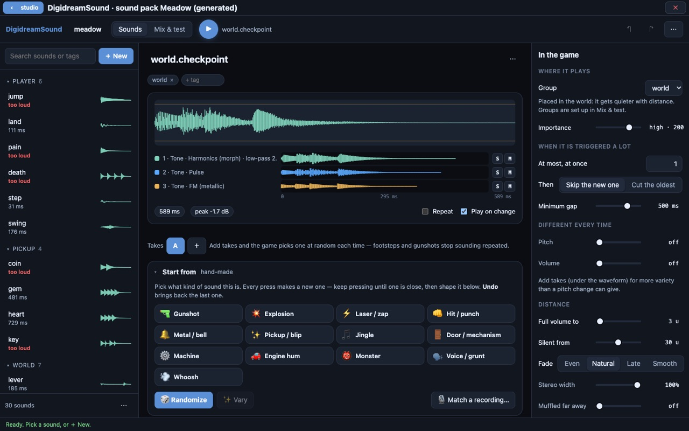

# DigidreamSound

A sound-effect editor and the small engine that plays its sounds in a game.
Each sound is saved as a **recipe, not a recording**: a synthesis patch and a
few settings, a few hundred bytes of JSON. You start from a kind of sound
(gunshot, explosion, pickup, door...), shape it with sliders, give it
variations, and decide how the game plays it: how loud, how far away it can be
heard, how many copies may play at once. What you hear in the editor is what
the game plays, on every platform.



## Download

The latest release is at
[github.com/projectdigidream/digidream-sound/releases/latest](https://github.com/projectdigidream/digidream-sound/releases/latest):

| Platform | File |
|---|---|
| macOS, Apple silicon | `digidream-sound-<version>-macos-arm64.dmg` (or `.zip`) |
| macOS, Intel | `digidream-sound-<version>-macos-x64.dmg` (or `.zip`) |
| Windows x64 | `digidream-sound-<version>-windows-x64-setup.exe` (or a `.zip` that needs no install) |
| Linux x64 | `digidream-sound-<version>-linux-x64.AppImage` (or `.tar.gz`) |
| Android | `digidream-sound-<version>-android.apk` (sideload it) |
| Web | `digidream-sound-<version>-web.zip`: a static site to host yourself |

**macOS:** the apps are not notarized. The first time, open System Settings >
Privacy & Security and click **Open Anyway**.

**Web:** unzip, then `cd web && node serve.js --root .` and open
`http://localhost:8940/`. On another host, serve the folder over HTTPS: browsers
only let a page play audio this way in a secure context (`localhost` counts as
one), and `.mjs` files must be served as `text/javascript`.

DigidreamSound also comes inside **Digidream Studio**
([digidream-studio](https://github.com/projectdigidream/digidream-studio)) as a
plugin. There you do not need this download at all: in the studio's Sounds page,
press **+ new sound pack**, or **edit in DigidreamSound** on a pack. The editor
opens over the studio, and **‹ studio** saves the pack back into your module.

## Use it

1. Open the app (in a browser, press **Start** first: browsers only make sound
   after a click). The small example bank opens, so there is always something
   to play.
2. **+ New** adds a sound. Name it the way the game asks for it, for example
   `weapon.pistol.fire`.
3. Under **Start from**, press a kind of sound. Every press makes a new one;
   keep pressing until one is close, then shape it with the sliders below.
4. Add **takes** (variations). The game picks one at random each time, so
   repeated sounds do not sound the same.
5. On the right, **In the game** sets the group it plays on, its importance,
   how many may play at once, and how it fades with distance.
6. **Match a recording...** reads a reference sound and finds a recipe that
   sounds like it. The recording is analysed and thrown away; only the recipe
   is kept.
7. **Mix & test** sets up the groups and plays the bank in the real engine.
8. **Save** (⌘S / Ctrl+S) the `.sfxproj`. **⋯ > Export for the game** writes the
   `.sfxb` the game loads.

The full user guide, screen by screen, is [tool/README.md](tool/README.md).

### Files

| File | What it is |
|---|---|
| `.sfxproj` | the sound bank you edit: JSON, readable by hand. Keep this one |
| `.sfxb` | the baked bank the game loads, sealed with a checksum |
| `.wav` | **⋯ > Export this sound as WAV** writes one take, 48 kHz stereo; **Match a recording** reads one |

No bank ever contains a recording, only recipes. The field-by-field format is
[docs/SFX_FORMAT.md](docs/SFX_FORMAT.md).

## Build from source

DigidreamSound does not carry its own synthesis code: it compiles the DSP of
**DigidreamSynth** from source, and one header (`dnp/math/fixed.hpp`, the
fixed-point types) from the **Digidream Engine**. So a build needs those two
repositories checked out beside this one, under these exact folder names:

```sh
mkdir digidream && cd digidream
git clone https://github.com/projectdigidream/digidream-sound.git sound
git clone https://github.com/projectdigidream/digidream-midisynth.git midisynth
git clone https://github.com/projectdigidream/digidream-engine.git engine
cd sound
```

The build reads `../midisynth/src` and `../engine/core/include`. To keep them
elsewhere, set `DSND_SYNTH_DIR` (midisynth's `src` folder) and `DSND_FIXED_DIR`
(the engine's `core/include` folder): with `-D` for cmake, and in the
environment for `build_wasm.sh` and `make_standalone.sh`.

You need:

- a C++17 compiler (clang or gcc), CMake 3.20 or newer and Ninja
- Node (the editor's server, the tests and the app packaging)
- Emscripten, for the WebAssembly engine the editor runs on. The engine pins
  version 6.0.8 (its `scripts/setup_emsdk.sh`); that is the one these builds
  are tested with. The script finds `em++` on your `PATH` (after
  `source emsdk_env.sh`), in `../emsdk`, or wherever `EMXX` points.

The editor's engine files (`tool/dist/`) are build output and are not in the
repository, so build them first:

```sh
./scripts/build_wasm.sh       # -> tool/dist/dsound.mjs and dsound-tool.mjs
node tool/serve.js            # then open http://localhost:8940/tool/sfx.html
```

The native library, the command-line tools and the tests:

```sh
cmake -S . -B build -G Ninja && ninja -C build
```

Packaging (each one runs `package_web.sh` first, so all three ship the same
page):

```sh
./scripts/package_web.sh             # a static site in dist-web/
./scripts/package_electron.sh        # the desktop app for this machine, in electron/dist/
./scripts/package_electron.sh --all  # macOS (arm64 + x64), Windows x64 and Linux x64
./scripts/package_android.sh         # build/android/digidreamsound.apk
```

The desktop app uses Electron, which `package_electron.sh` installs with npm on
its first run. The Android APK is built from the Android SDK alone (no Gradle,
no NDK): it needs `ANDROID_HOME` pointing at an SDK with build-tools and a
platform, and a JDK (17) with `javac` on the `PATH`. An iOS build is set up
through Capacitor (`scripts/package_ios.sh`, needs Xcode and CocoaPods) but has
not been built yet.

A build that does not need the sibling repositories can be made once, from a
full checkout: `./scripts/make_standalone.sh` copies the borrowed sources into
`build/standalone/src/vendor`, and that tree builds on its own.

## Development

Tests, the release gate, the formats, the fitter and how the engine stays
identical on every platform: [DEVELOPING.md](DEVELOPING.md). Embedding the
engine in a game: [docs/EMBEDDING.md](docs/EMBEDDING.md). Design background:
[docs/SOUND.md](docs/SOUND.md).

## Licence

MIT, see LICENSE.
